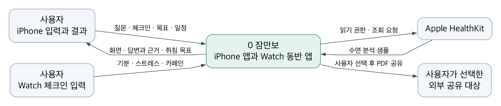
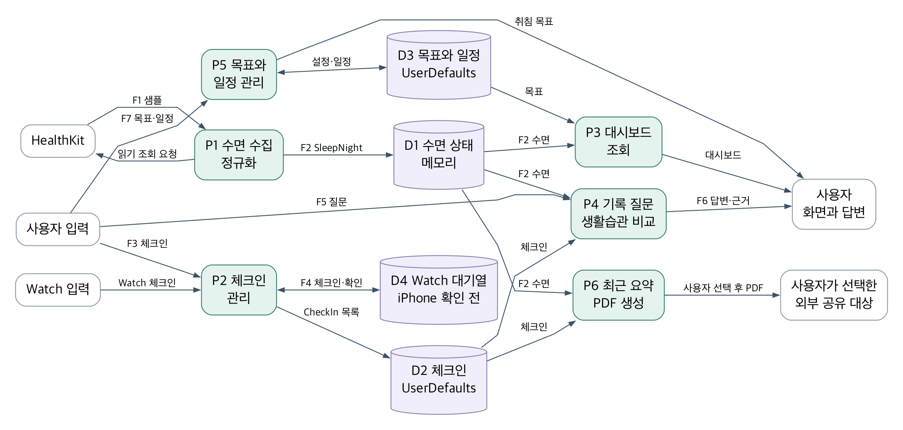
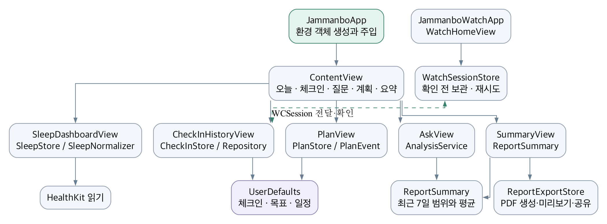

# 잠만보 소프트웨어 구조와 애플리케이션 설계

SSAD v1.3 · 2026-11-07

> 2026-11-08 P03·P05 후속 변경: 운동·질문 표현·일정 조정·선택 PDF와 동의 흐름의 최신 설계는 [피드백 반영 명세](../qa/Feedback_P03_P05_2026-11-08.md)를 따른다. 아래 v1.3 본문과 기존 제출 DOCX·PDF는 변경 전 구조 기록이다.

잠만보는 HealthKit 수면 기록과 iPhone 또는 Apple Watch의 생활습관 체크인을 연결하는 네이티브 프로토타입이다. 현재 구현은 기기 안에서 기록을 요약하고 목표 취침 시각을 계산하며 상담에 참고할 PDF를 만든다. 이 문서는 구조적 분석의 DFD, 모듈 구조, 자료 사전과 소단위 명세를 실제 Swift 구현에 연결한다.

## 1 제품 범위와 시스템 경계

| 항목 | 현재 설계 |
|---|---|
| 실행 환경 | iOS 17 이상, watchOS 10 이상, SwiftUI |
| 앱 구성 | Jammanbo iPhone 앱과 JammanboWatch 동반 앱. 첫 사용자 테스트는 iPhone 중심으로 진행하고 Watch 전달은 별도 검증한다. |
| 외부 시스템 | HealthKit 읽기 전용 접근, 사용자가 선택한 시스템 공유 대상 |
| 내부 처리 | WatchConnectivity 전달, 기기 내 규칙 계산, UserDefaults 저장, 임시 PDF 생성 |
| 제외 범위 | 생성형 LLM, 외부 캘린더 동기화, 서버 계정, 클라우드 백업, 주간 일정 최적화 |
| 실기기 상태 | 사용자 보고로 iPhone 앱 실행을 확인했다. HealthKit 결과, Watch 전달, 실제 사용자 과업 결과는 별도 검증이 필요하다. |

iPhone 앱과 Watch 앱을 함께 시스템 경계 안에 둔다. 문맥도에서 Watch 입력 주체는 Watch를 조작하는 사용자이며, Watch 앱 자체를 외부 시스템으로 해석하지 않는다. 상담자는 계정이나 직접 연결이 없고 사용자가 PDF를 공유한 경우에만 결과를 받는다.

## 2 문맥 DFD

사용자는 질문, 체크인, 목표와 일정을 입력하고 화면 결과를 받는다. HealthKit에는 읽기 권한과 조회를 요청하고 수면 분석 샘플을 받는다. 외부 공유는 사용자가 생성한 PDF에 대해 공유 시트에서 대상을 선택할 때만 시작된다.

| 흐름 | 입력 또는 출력 | 경계 |
|---|---|---|
| 사용자 입력 | 질문, 체크인, 수면 목표, 수동 일정 | 사용자에서 앱으로 |
| 사용자 결과 | 대시보드, 답변과 근거, 취침 목표, 요약 | 앱에서 사용자로 |
| 수면 조회 | 권한 및 조회 요청, HKCategorySample 목록 | 앱과 HealthKit 사이 |
| 선택적 공유 | 요약 PDF | 앱에서 사용자가 고른 외부 대상으로 |

## 3 Level 1 DFD

| 프로세스 | 책임 | 주요 데이터 |
|---|---|---|
| P1 수면 수집과 정규화 | 겹침을 제거하고 수면 세션의 기상일로 합산 | F1 수면 샘플에서 F2 SleepNight 목록으로 |
| P2 체크인 관리 | iPhone 입력과 Watch 전송을 검증하고 UUID 중복 제거 | F3 폰 입력, F4 Watch payload, D2 체크인 |
| P3 대시보드 조회 | 최근 수면, 제공된 단계, 목표 대비 비율 표시 | F2 수면 기록, D3 수면 목표 |
| P4 기록 질문과 비교 | 질문 분류, 기록 평균, 단계 조회, 같은 날짜 비교 | F5 질문에서 F6 답변과 근거로 |
| P5 목표와 일정 관리 | 취침 목표 계산, 수동 일정 추가와 삭제 | F7 목표와 일정, D3 로컬 저장 |
| P6 요약과 PDF | 같은 기간으로 화면과 PDF 구성 | F8 ReportSummary에서 임시 PDF로 |

DFD 화살표는 자료의 이동을 나타낸다. 실행 순서나 함수 호출은 의미하지 않는다. D1은 수면 상태의 메모리 보관이며 UserDefaults에 수면 원본을 복사하지 않는다. D2는 기록 시각순 최근 30개 체크인과 별도의 수신 UUID 이력, D3은 목표와 일정, D4는 iPhone 저장 확인 응답을 기다리는 Watch 대기열이다.

## 4 애플리케이션 모듈 구조

JammanboApp은 SleepStore, CheckInStore, PlanStore를 생성하고 환경 객체로 주입한다. 화면은 사용자 상호작용과 표시를 담당한다. AskView는 AnalysisService에 계산을 위임하고 PlanView는 PlanStore를 통해 목표와 일정을 변경한다. ReportSummary는 질문, 요약 화면, PDF가 사용하는 최근 7일 범위를 공유한다.

이 구조도는 SwiftUI의 구성과 의존 관계를 보여준다. 서로 다른 프로세스에서 실행되는 Watch 앱과 iPhone 앱 사이에는 직접 함수 호출이 없으며 WatchConnectivity 비동기 메시지만 전달한다.

| 모듈 | 역할 | 접근 경계 |
|---|---|---|
| SleepStore / SleepNormalizer | 권한, 자동 조회, 출처 겹침 제거, 세션별 집계 | HKHealthStore / Foundation 계산 |
| CheckInStore / CheckInRepository | 폰 입력·수정·삭제, Watch 수신 확인, 최근 30건 보관 | WCSession / 주입 가능한 UserDefaults |
| WatchSessionStore / CheckInOutbox | 확인 응답까지 대기열 유지, 오류·미확인 재시도 | Watch UserDefaults와 WCSession |
| CheckInMessage / DeliveryRetryState | 공통 payload·확인 응답, 중복 전송 방지와 재시도 시각 | 두 타깃의 Shared 코드 |
| SleepHistoryView / CheckInHistoryView | 최근 7일 수면, 전체 체크인 목록과 상세 | 화면과 각 Store |
| AnalysisService | 평균, 단계, 생활습관 비교와 근거 생성 | 전달받은 ReportSummary만 읽음 |
| PlanStore | 목표와 일정의 상태, 계산, 로컬 저장 | UserDefaults를 주입 가능 |
| ReportSummary | 최근 7개 달력 날짜의 수면과 체크인 필터 | Foundation 값 타입 |
| ReportPDFGenerator | 화면과 같은 요약으로 PDF 렌더링 | UIKit과 임시 파일 |
| ReportExportStore / PDFPreviewSheet | 내용 변경 시 PDF 무효화, 내부 미리보기와 공유 | 스냅샷 상태 / PDFKit·시스템 공유 시트 |

## 5 DFD와 코드와 요구사항 추적

| DFD | 구현 파일 | SSRD | 확인 과업 |
|---|---|---|---|
| P1과 P3 | Health/SleepStore.swift, SleepNormalizer.swift, SleepHistoryView.swift | FR-01, FR-02, FR-04 | T1 수면과 출처 |
| P2 | CheckIn/CheckInStore.swift, CheckInRepository.swift, CheckInHistoryView.swift, WatchSessionStore.swift | FR-03, FR-04 | T2a 폰 체크인, T2b Watch 전달 |
| P4 | Analysis/AnalysisService.swift, AskView.swift, Reporting/ReportSummary.swift | FR-05, FR-06, FR-07 | T3 질문과 근거 |
| P5 | Planning/PlanStore.swift, PlanView.swift | FR-08, FR-09, FR-10 | T4 목표와 일정 |
| P6 | Reporting/ReportSummary.swift, ReportExportStore.swift, PDFPreviewSheet.swift, ReportPDFGenerator.swift | FR-11, FR-12 | T5 요약과 PDF |

파일 경로의 기준은 iPhone 소스의 경우 Jammanbo이며 WatchSessionStore는 JammanboWatch/Connectivity에 있다. UI 과업 ID는 고객 테스트 패킷과 공유한다. AI 코드 리뷰는 보조 검토이며 실제 사용자의 과업 결과와 구분해 기록한다.

## 6 자료 흐름 사전

| ID | 자료 구성 | 발신과 수신 |
|---|---|---|
| F1 | HKCategorySample의 startDate, endDate, value 목록 | HealthKit에서 SleepStore |
| F2 | SleepNight 목록과 sourceLabel, message | SleepStore에서 대시보드와 ReportSummary |
| F3 | mood, stress, caffeine | CheckInView에서 CheckInStore |
| F4 | id, timestamp, mood, stress, caffeine | WatchSessionStore에서 WCSession을 거쳐 CheckInStore |
| F4 확인 응답 | kind=checkInReceipt, id | iPhone 저장·중복 확인 후 Watch 대기열로 |
| F5 | question String | AskView에서 AnalysisService |
| F6 | AnswerCard의 text, evidence | AnalysisService에서 AskView |
| F7 | wakeMinutes, sleepGoalMinutes, PlanEvent 목록 | PlanView와 PlanStore 사이 |
| F8 | ReportSummary 값 | SummaryView에서 ReportPDFGenerator |

## 7 자료 사전

| 자료 | 필드 | 의미와 제약 |
|---|---|---|
| SleepNight | id·date Date, startDate·endDate 선택 Date, 총·단계 분 Int | 기상일 합계와 첫 수면·마지막 기상 구간. 총 시간은 네 단계의 합. |
| 수면 단계 상태 | hasDeepStageData, hasRemStageData, hasCoreStageData, isSample은 Bool | 단계 미제공과 0분을 구분한다. 샘플 여부는 모든 분석에서 보존한다. |
| CheckIn | id UUID, date Date, mood String, stress String, caffeine Bool, source String | 출처 iPhone 또는 Apple Watch. 같은 UUID는 한 번만 반영하고 최근 30건 유지. |
| CheckInMessage | id UUID, timestamp Double, mood, stress, caffeine | payload는 UUID 문자열. 구형 단일 항목은 변환하고 생성한 UUID를 즉시 보관. |
| PlanEvent | id UUID, title String, time Date | 제목 앞뒤 공백 제거. 빈 제목 저장 거부. |
| 목표 설정 | wakeMinutes Int, sleepGoalMinutes Int | 기본 420분과 480분. 화면의 수면 목표는 360에서 600분, 15분 간격. |
| AnswerCard | text String, evidence String | 계산 결과와 근거. 영속 저장하지 않음. |
| ReportSummary | nights, checkIns, source, periodStart, generatedAt | 오늘 포함 최근 7개 달력 날짜. 수면 없는 날짜를 0분으로 채워 평균에 넣지 않음. |

| 저장소 | 키 또는 위치 | 보관 규칙 |
|---|---|---|
| D1 수면 상태 | SleepStore.nights 메모리 | 실제 조회 또는 샘플로 갱신. 수면 원본은 UserDefaults에 저장하지 않음. |
| D2 체크인 | jammanbo.checkins.v1 | JSON, 기록 시각 내림차순 최근 30건. 수정·삭제 후에도 저장. |
| D2 수신 이력 | jammanbo.checkinReceipts.v1 | 수신 UUID 최대 1,000개. 재전송이 수정·삭제한 기록을 되돌리지 않도록 함. |
| 연결 의사 | jammanbo.health.connectionRequested.v1 | 사용자가 건강 연결을 요청한 사실만 보관. 권한 허용 여부는 단정하지 않음. |
| D3 목표 | jammanbo.targetWakeMinutes, jammanbo.targetSleepMinutes | 정수 분 단위, 기존 저장 키 유지 |
| D3 일정 | jammanbo.planEvents.v1 | PlanEvent JSON 목록, 추가와 삭제 때 저장 |
| D4 Watch 대기열 | jammanbo.watch.pendingCheckIn.v1 | 최대 30건, iPhone 확인 응답 후 제거. 가득 차면 새 저장을 거부하고 안내. |
| PDF 출력 | 앱 임시 디렉터리, UUID를 포함한 파일명 | 생성 때 자체 PDF 중 24시간 지난 파일 정리. 공유는 사용자 선택. |

## 8 소단위 명세 수면과 체크인

### MS01 수면 정규화

입력은 최근 14일 HealthKit sleepAnalysis 샘플이다. SleepNormalizer는 구간 경계를 나누고 각 고유 시간 구간에 하나의 기록만 선택한다. 상세 단계가 미분류보다 우선하고, 그다음 Watch 출처를 우선한다. 같은 조건이면 출처 식별자 순으로 결정하며 같은 출처의 겹침에서는 awake를 우선한다. 잘못된 구간은 제외하고 미래 종료는 현재 시각까지 자른다.

인접 수면의 간격이 90분 이내이거나 하나의 inBed 구간 안에 있으면 같은 세션으로 묶는다. 세션 전체를 마지막 수면 종료의 로컬 기상일에 배정하고, 같은 날 끝난 낮잠과 세션은 합산한다. 이 90분은 앱의 분류 정책이다. awake와 inBed는 수면 합계에 넣지 않는다. 초 단위로 먼저 누적한 뒤 정수 분으로 표시하고 나머지를 단계에 배분해 합계가 일치하도록 한다.

총 시간이 0인 날짜를 제외하고 날짜 내림차순으로 정렬한다. 화면에는 오늘 포함 최근 7개 달력 날짜만 남긴다. 읽을 수 있는 기록이 없거나 조회에 실패하면 샘플 목록과 출처, 안내 문구를 함께 갱신한다. 빈 응답만으로 사용자가 읽기 권한을 거부했다고 단정하지 않는다.

단계가 없는 날짜는 단계 미제공으로 표시한다. 사용자가 한 번 연결을 요청했다면 다음 실행·앱 복귀·수동 새로고침 때 다시 조회한다. 실행 중 HealthKit 변경은 observer query로 반영한다. 최초 권한 요청은 연결 버튼에서만 시작한다. 최근 7일 전체 목록과 날짜별 단계·시작·종료·같은 날짜 체크인 상세를 제공한다.

### MS02 체크인 저장과 Watch 전달

iPhone 입력은 새 UUID와 입력 시각으로 CheckIn을 만들고 출처를 iPhone으로 설정한다. Watch는 고정 UUID를 가진 항목을 UserDefaults 대기열에 먼저 보관한다. 최대 30건이며 가득 차면 새 입력을 거부하고 재시도 안내를 표시한다. WCSession 활성화와 동반 앱 설치를 확인한 뒤 transferUserInfo로 예약한다. 예약·운송 성공만으로 대기열을 지우지 않는다.

iPhone은 UUID, 유효한 시각, mood·stress·caffeine 타입을 검사한다. 기록 시각 내림차순으로 정렬한 최근 30건을 보관하고, 수신 UUID 이력 1,000개로 중복을 제거한다. 저장 또는 중복 확인 후 같은 UUID의 확인 응답을 보낸다. 구형 payload는 ID가 없을 때만 UUID를 생성하며 기록 시각은 필요하다. 전체 목록에서 상세를 열어 값 수정과 삭제를 수행할 수 있다. 원래 기록 시각·출처는 유지한다.

Watch는 확인 응답을 받으면 해당 UUID만 대기열에서 제거하고 마지막 확인 시각을 표시한다. 전송 오류는 5초부터 최대 300초까지 간격을 늘려 재시도하며 운송 성공 후 확인 응답이 없으면 60초 뒤 재시도한다. 이미 시스템에서 운송 중인 UUID는 중복 예약하지 않는다. 앱 복귀·연결 변경·수동 재시도와 WatchConnectivity 백그라운드 전달을 처리한다. 수신 UUID 이력이 남은 동안 재전송은 iPhone에서 수정·삭제한 값을 되돌리지 않는다. 실제 전달·오프라인 재연결은 페어링된 기기에서 검증해야 한다.

## 9 소단위 명세 질문과 계획

### MS03 기록 질문과 생활습관 비교

AskView는 질문과 ReportSummary를 AnalysisService에 전달한다. 앞뒤 공백을 지우고 소문자로 변환한다. 빈 질문, 수면 기록 없음, 지원하지 않는 질문은 각각 안내를 반환한다. 평균 질문은 존재하는 수면 기록만 평균하고 사용한 날짜와 출처를 표시한다.

수면 단계 질문은 최근 7일 안에서 해당 단계가 제공된 가장 최근 기록을 사용한다. 단계가 없으면 0분으로 해석하지 않고 미제공을 알린다. 생활습관 비교는 샘플 수면을 포함하면 계산하지 않는다. 실제 수면에 대해서만 같은 날짜의 체크인을 결합하며 하루 여러 체크인 중 가장 늦게 입력한 한 건을 사용한다.

카페인 있음과 없음 또는 높은 스트레스와 나머지 조건에 각각 최소 2일이 있어야 평균 차이를 계산한다. 부족하면 각 조건의 기록 수와 날짜를 근거로 보여준다. 차이가 0이면 차이 없음을 표시한다. 같은 날짜의 관찰 비교이며 전날 습관의 영향, 인과관계 또는 임상 효과로 해석하지 않는다.

### MS04 목표와 일정

PlanStore는 기존 UserDefaults 키에서 기상 분, 수면 목표 분과 일정을 읽는다. 기본 목표는 07:00 기상과 480분 수면이다. 화면에서 수면 목표는 360에서 600분 범위의 15분 간격으로 변경한다. 취침 목표는 해당 날짜의 기상 시각에서 목표 수면 분을 차감한다.

07:00과 480분은 전날 23:00을 반환한다. 이 값은 목표 시각이며 미래 알람이나 주간 최적화 결과가 아니다. 일정은 제목의 공백을 지우고 비어 있지 않을 때만 추가한다. 추가와 삭제 후 JSON을 저장한다. 일정은 목록에 표시되며 취침 목표 계산에 자동 반영되지 않는다.

## 10 소단위 명세 요약과 품질 경계

### MS05 요약과 PDF

SummaryView는 ReportSummary로 화면을 구성하고 같은 값을 ReportPDFGenerator에 전달한다. 기간은 오늘 포함 최근 7개 달력 날짜이며 체크인도 같은 기간으로 제한한다. 평균은 존재하는 수면 일수로 나눈다. PDF는 595×842 포인트 한 페이지에 생성일, 날짜 범위, 평균, 기록 일수, 체크인 수, 수면 출처와 날짜별 단계를 표시한다.

단계가 없으면 미제공으로 표시하고 미분류 분은 별도로 출력한다. UUID가 포함된 이름으로 앱 임시 디렉터리에 원자적으로 저장한다. 생성 직전의 ReportContent와 PDF를 함께 보관하고 앱 내부 PDFKit 미리보기에 생성 시각·출처·공유 버튼을 표시한다. 기록·출처·기간이 바뀌면 기존 PDF와 공유 버튼을 무효화하며 직접 공유할 때도 현재 값으로 다시 생성한다. 생성 시 자체 임시 PDF 중 24시간 지난 파일만 정리한다. 공유 대상은 사용자가 시스템 시트에서 선택한다. 진단서나 치료 지시로 표현하지 않는다.

| 결정 | 구현과 남은 검증 |
|---|---|
| 기기 내 처리 | 건강 기록을 앱 서버나 LLM으로 전송하지 않음. 향후 연동 때 별도 전송 범위 설계. |
| 로컬 저장 | UserDefaults는 전용 암호화 건강 저장소가 아님. 상용 배포 전에 보호와 삭제 정책 검토. |
| 분리된 계산 | 정규화·기록 저장·전송 큐·분석·계획·PDF 스냅샷을 UI 없이 검증. 자동 검사 61개 통과. |
| 계획 저장 | PlanStore에 UserDefaults 주입 가능. 기존 키를 유지해 기존 목표와 일정 호환. |
| 실기기 확인 | HealthKit 기록과 단계, 겹치는 출처, Watch 재연결과 전달, PDF 공유를 기기에서 검증. |
| 사용자 검증 | 동의한 실제 참여자의 과업 성공, 시간, 도움과 의견을 수집. 결과를 추정해 채우지 않음. |

참고 기준은 Jammanbo_SSAD_Application_Structure.docx의 구조적 분석과 설계 항목이다. 최신 구현 명세는 이 문서와 03_Jammanbo_SSAD.docx에 통합했다. 참고 문서는 제공받은 원본 상태로 보존한다.
